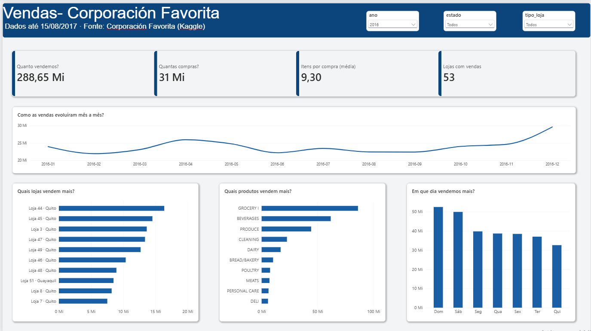
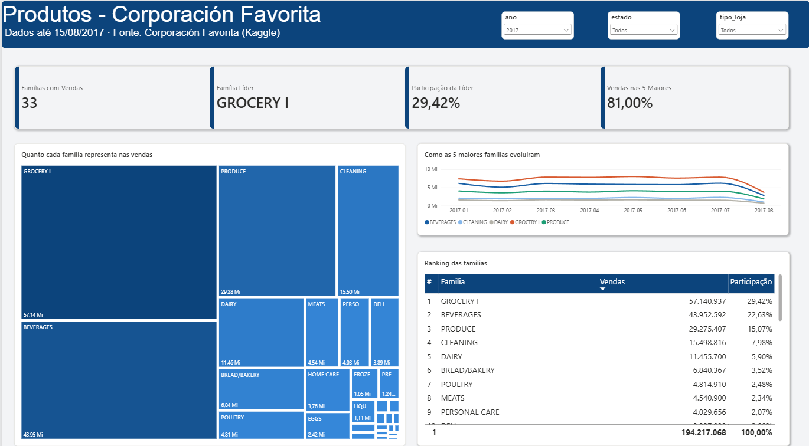
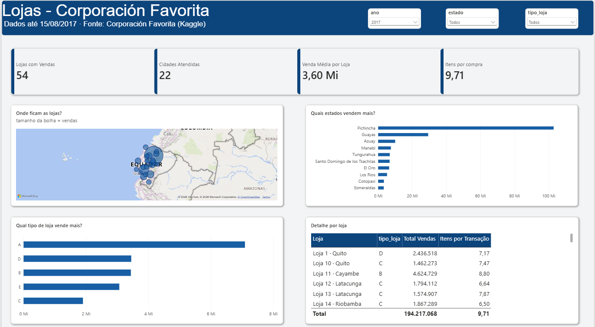
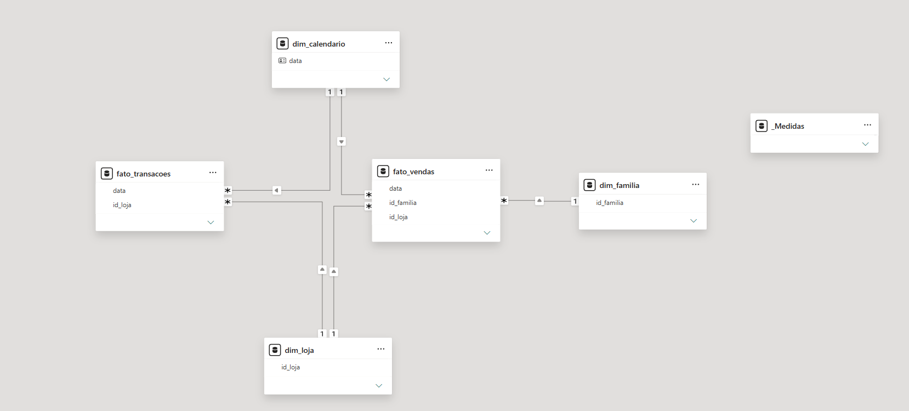

# Pipeline de dados e dashboard de varejo · Corporación Favorita

Projeto de ponta a ponta com dados públicos de uma rede de supermercados: um pipeline ETL em **Python** que trata cerca de 3 milhões de registros e os carrega num **modelo estrela no MySQL**, consumido por um **dashboard no Power BI**.

## Contexto

Os dados são da **Corporación Favorita**, rede de supermercados do Equador, disponibilizados no Kaggle na competição [Store Sales - Time Series Forecasting](https://www.kaggle.com/competitions/store-sales-time-series-forecasting/data).

- 54 lojas em 22 cidades
- 33 famílias de produto
- Vendas diárias de 01/01/2013 a 15/08/2017
- Cerca de 3 milhões de registros de vendas, além de transações, preço do petróleo e feriados

A base não contém valores monetários: as vendas representam **unidades vendidas**.

## Arquitetura

```
CSVs do Kaggle
      │
      ▼
extract.py  →  transform.py  →  load.py
      │
      ▼
MySQL (modelo estrela)
      │
      ▼
Power BI
```

O arquivo `main.py` orquestra as três etapas, e o pipeline completo roda com um único comando.

## Dashboard

### 1. Vendas · quanto vendemos?



**Objetivo:** dar a visão geral do desempenho no período selecionado.

**Estrutura:**
- **KPIs:** volume vendido, número de compras, itens por compra e lojas ativas.
- **Linha do tempo mensal**, ocupando a largura da página, para evidenciar tendência e sazonalidade.
- **Três visuais lado a lado**, que aprofundam a visão geral: as 10 lojas e os 10 produtos que mais vendem, e as vendas por dia da semana.

### 2. Produtos · o que vendemos?



**Objetivo:** entender a composição das vendas e o quanto elas se concentram em poucas famílias de produto.

**Estrutura:**
- **KPIs:** famílias com vendas, família líder, participação da líder e participação das 5 maiores.
- **Mapa de árvore** ocupando metade da página, com um gradiente de azul proporcional às vendas.
- **Evolução das 5 maiores famílias** ao longo do tempo.
- **Ranking completo** das 33 famílias, com volume e participação.

### 3. Lojas · onde vendemos?



**Objetivo:** mostrar a distribuição geográfica das vendas e comparar os formatos de loja.

**Estrutura:**
- **KPIs:** lojas com vendas, cidades atendidas, venda média por loja e itens por compra.
- **Mapa** com bolhas proporcionais às vendas de cada cidade.
- **Os 10 estados** que mais vendem.
- **Venda média por tipo de loja** (de A a E).
- **Tabela de detalhe** com cada loja, o tipo, as vendas e os itens por compra.

## Principais descobertas

- **Concentração em poucas famílias:** em 2017, as 5 maiores famílias de produto somaram 81% do volume vendido, e a líder (GROCERY I) sozinha respondeu por 29%.
- **Fim de semana e dezembro são os picos:** sábado e domingo vendem bem mais que os dias úteis, e dezembro é o mês mais forte do ano.
- **Efeito do terremoto de 2016:** abril de 2016 aparece acima dos meses vizinhos. Em 16/04/2016, um terremoto de magnitude 7,8 atingiu o Equador, e a documentação da base menciona o impacto das doações nas vendas.
- **Lojas tipo A vendem muito mais por loja:** na comparação pela venda média por loja (e não pelo total, que favoreceria os tipos com mais lojas), o tipo A lidera com folga.
- **Vendas concentradas em Pichincha**, estado da capital, Quito.
- **Mudança no registro dos dados:** a família PRODUCE (hortifrúti) praticamente não aparece em 2013 e passa a ter volume relevante depois. Isso indica que parte do "crescimento" entre os anos vem de categorias que começaram a ser registradas, e não de aumento real de consumo. Por isso, comparações entre anos exigem cuidado.

## Modelo de dados



- **Duas tabelas fato com grãos diferentes:** vendas por loja, família e dia; transações por loja e dia. Mantê-las separadas evita que o número de transações se repita para cada família e distorça as somas.
- **Chave primária composta** na `fato_vendas` (`data`, `id_loja`, `id_familia`), garantindo no próprio banco que não existam duplicidades.
- **Dimensão de calendário completa**, com feriados nacionais e preço do petróleo, marcada como tabela de datas no Power BI.

## Tratamentos aplicados no ETL

| Problema encontrado | Tratamento |
|---|---|
| 8 lojas inauguradas depois de 2013, com vendas zero registradas antes da abertura | Remoção das linhas anteriores à primeira venda de cada loja (222.057 linhas) |
| Dias de Natal ausentes (lojas fechadas) | Dimensão de calendário com todos os dias do período |
| Petróleo sem preço em fins de semana e com valores vazios | Preenchimento com o último preço conhecido (*forward fill*) |
| Feriados transferidos para outras datas | Considerados apenas os feriados efetivamente celebrados |
| Nome da família repetido 3 milhões de vezes | Dimensão de família com chave numérica |

A análise exploratória completa está em [`notebooks/01_exploracao.ipynb`](notebooks/01_exploracao.ipynb).

## Tecnologias

- **Python:** pandas, SQLAlchemy, PyMySQL, python-dotenv
- **Banco de dados:** MySQL 8
- **BI:** Power BI Desktop (DAX, modelo estrela, formato .pbip)
- **Exploração:** Jupyter Notebook
- **Versionamento:** Git e GitHub

## Estrutura do projeto

```
etl-varejo/
├── dashboard-varejo-favorita/   # projeto do Power BI (.pbip) e tema
├── data/raw/                    # CSVs originais (não versionados)
├── imagens/                     # prints do dashboard e do modelo
├── notebooks/
│   └── 01_exploracao.ipynb      # análise exploratória
├── sql/
│   └── create_tables.sql        # criação do modelo estrela
├── src/
│   ├── conexao.py               # conexão com o MySQL via variáveis de ambiente
│   ├── extract.py               # leitura dos CSVs
│   ├── transform.py             # limpeza e modelagem
│   ├── load.py                  # carga no MySQL
│   └── main.py                  # orquestração do pipeline
├── .env.example
└── requirements.txt
```

## Como executar

**Pipeline**

1. Clone o repositório e crie o ambiente virtual:
   ```bash
   git clone https://github.com/naticost/etl-varejo.git
   cd etl-varejo
   python -m venv venv
   source venv/Scripts/activate   # no Linux/Mac: source venv/bin/activate
   pip install -r requirements.txt
   ```
2. Baixe os dados da [competição no Kaggle](https://www.kaggle.com/competitions/store-sales-time-series-forecasting/data) e extraia os CSVs em `data/raw/`.
3. No MySQL, crie o banco com `CREATE DATABASE varejo_favorita;` e execute o script `sql/create_tables.sql`.
4. Copie o `.env.example` para `.env` e preencha suas credenciais.
5. Execute:
   ```bash
   python src/main.py
   ```

**Dashboard**

1. Abra o arquivo `dashboard-varejo-favorita/dashboard-varejo-favorita.pbip` no Power BI Desktop.
2. Atualize a conexão com o seu MySQL local. O Power BI precisa do **MySQL Connector/NET** (a versão 8.0.28 funcionou neste projeto).
3. Para o mapa, habilite os visuais de mapa em **Arquivo → Opções → Segurança**.

## Autora

**Natiele Costa** · Analista de Dados
[LinkedIn](https://www.linkedin.com/in/natiele-costa-7118351a1) · [GitHub](https://github.com/naticost)
